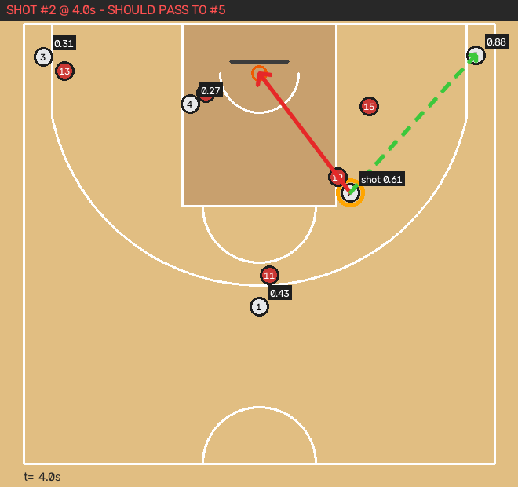

# basketball – ניתוח החלטות: זריקה מול מסירה

אב-טיפוס שהופך סרטון קצר ממשחק כדורסל למפת מגרש דו-ממדית (מבט-על). בכל רגע שבו שחקן זרק או מסר, הכלי בודק אם זו הייתה ההחלטה הנכונה.

```
סרטון ──► זיהוי שחקנים + כדור (YOLO + ByteTrack)
      ──► מפה דו-ממדית (כיול מצלמה / Homography)
      ──► חלוקה לקבוצות לפי צבע חולצה
      ──► מי מחזיק בכדור, מתי הייתה מסירה ומתי זריקה
      ──► השוואת נקודות צפויות: זריקה מול כל מסירה אפשרית
      ──► דוח בעברית + תמונות מפה + וידאו דו-ממדי
```

## התקנה

```bash
python -m venv .venv && source .venv/bin/activate
pip install -r requirements.txt
```

## ממשק web (הדרך הקלה)

```bash
python -m courtvision serve
```

פותחים בדפדפן את http://localhost:8000. התהליך:

1. **העלאה**: גוררים לדף סרטון, או לוחצים "נסו את הדמו".
2. **סימון המגרש**: בוחרים נקודה ברשימה או במגרש הקטן ולוחצים עליה בתמונה. זכוכית מגדלת בפינה עוזרת לדייק. צריך לפחות 4 נקודות רצפה ואת מרכז הטבעת. "הצג קווי מגרש" מצייר את קווי המגרש לפי הסימון, וכך רואים מיד אם הכיול נכון. הכיול נשמר בדפדפן, ובסרטון הבא מאותה מצלמה לוחצים "טען כיול אחרון".
3. **תוצאות**: נתונים מסכמים, סרטון של הווידאו המקורי לצד המפה, וכרטיס לכל החלטה עם תמונת מפה והסבר.
4. **תיקון ידני**: אם הכלי פספס זריקה או מסירה, עוצרים את הסרטון ברגע הנכון, מוסיפים אירוע ולוחצים "נתח שוב". הזיהוי לא רץ מחדש, ולכן זה מהיר.

הסרטונים והתוצאות נשמרים בתיקייה `workspace/`.

## להתחיל מהדמו (בלי סרטון)

```bash
python -m courtvision demo
```

הדמו מריץ מהלך סינתטי: #1 מוסר ל-#2 בכנף, #2 חודר לחצי מרחק, המגן של #5 עוזב את הפינה כדי לעזור, ו-#2 זורק זריקה מכוסה.


התוצאה בתיקייה `demo_output/`:

| קובץ | מה יש בו |
|---|---|
| `report.md` | הדוח בעברית, החלטה אחרי החלטה |
| `decisions/*.png` | מפת המגרש ברגע ההחלטה. חץ אדום: מה שנעשה. חץ ירוק מקווקו: ההמלצה. המספרים: נקודות צפויות לכל אפשרות |
| `court2d.webm` / `court2d.mp4` | הסרטון המקורי לצד המפה הדו-ממדית, עם עצירה בכל החלטה |
| `tracks.csv` | המיקום של כל שחקן במטרים, בכל פריים |
| `report.json` | כל הנתונים, לשימוש באפליקציה |

## הרצה על סרטון אמיתי

### 1. צילום
- **מצלמה קבועה** (חצובה), גבוהה ככל האפשר, שרואה את כל חצי המגרש. כיול אחד מכסה את כל הסרטון, ולכן המצלמה לא יכולה לזוז.
- קטעים קצרים של התקפה אחת או כמה התקפות.

### 2. כיול: איפה המגרש בתמונה
הכלי צריך לפחות 4 נקודות מוכרות על הרצפה, בלי ששלוש מהן יהיו על אותו קו. ככל שיש יותר נקודות, הדיוק טוב יותר.

```bash
# אפשרות א': לחיצה על הנקודות בחלון (דורש מחשב עם מסך)
python -m courtvision calibrate game.mp4 --out calibration.json

# אפשרות ב': לשמור את הפריים הראשון כתמונה ולמלא את הפיקסלים ידנית בקובץ JSON
python -m courtvision calibrate game.mp4 --frame-out frame.png
```

דוגמה לקובץ: `examples/calibration_example.json`. השמות של הנקודות האפשריות:

| שם | איפה במגרש |
|---|---|
| `baseline_left_corner` / `baseline_right_corner` | פינות קו הסיום |
| `corner3_baseline_left` / `corner3_baseline_right` | המקום שבו קו השלוש בפינה פוגש את קו הסיום |
| `lane_baseline_left` / `lane_baseline_right` | פינות הצבע על קו הסיום |
| `lane_ft_left` / `lane_ft_right` | פינות הצבע על קו העונשין |
| `three_point_top` | ראש קשת השלוש, מול הסל |
| `midcourt_left` / `midcourt_center` / `midcourt_right` | קו האמצע: בצד שמאל, במרכז, בצד ימין |

"שמאל" ו"ימין" נקבעים כשעומדים בקו האמצע ומסתכלים על הסל. בנוסף מסמנים את `rim` (מרכז הטבעת בתמונה), וכך הכלי יודע מתי הכדור הגיע לסל, כלומר שהייתה זריקה.

### 3. ניתוח
```bash
python -m courtvision analyze game.mp4 --calib calibration.json --out output
```

- `--model yolo11m.pt`: מודל גדול יותר, מדויק יותר ואיטי יותר. בדרך כלל זה בעיקר משפר את זיהוי הכדור.
- `--events events.json`: אם הזיהוי האוטומטי של מסירות וזריקות מפספס, אפשר לכתוב אותן ידנית (ראו `examples/events_example.json`). את מספרי השחקנים לוקחים מסרטון ה-court2d.

## איך מחושבת ההחלטה

לכל רגע של זריקה או מסירה:

1. **שווי הזריקה** = אחוז קליעה ממוצע לפי האזור × 2 או 3 נקודות × מקדם לחץ לפי המרחק מהמגן הקרוב (צמוד, מכוסה, פנוי, פנוי לגמרי).
2. **שווי מסירה לכל חבר קבוצה** = שווי הזריקה של המקבל אחרי שההגנה מספיקה לסגור עליו בזמן שהכדור בדרך, × הסיכוי שהמסירה תגיע (מגן שעומד בנתיב המסירה מוריד את הסיכוי).
3. אם האפשרות הטובה ביותר שווה יותר מ-0.12 נקודות ממה שנעשה, הכלי ממליץ עליה.

הפרמטרים נמצאים ב-`courtvision/decision.py` (`DEFAULT_ZONE_FG`, `DecisionConfig`). אלה ממוצעי ליגה מקורבים, והם מיועדים להשוואה בין אפשרויות באותו רגע.

## מגבלות ידועות ושלבים הבאים
- **זיהוי הכדור** במודל הכללי (COCO) חלש, בעיקר כשהכדור קטן או מטושטש. השלב הבא הוא אימון YOLO על דאטה-סט כדורסל (למשל מ-Roboflow Universe) עם המחלקות `player`, `ball`, `rim`. הקוד כבר תומך במודל כזה: הוא מזהה מחלקות לפי השם.
- **שופטים וקהל** עלולים להיכנס לחלוקה לקבוצות אם הם עומדים בתוך המגרש.
- **החלפת מזהה**: כשהשחקנים מסתירים זה את זה, מזהה של שחקן עלול להתחלף.
- **מסירה נמדדת רק לפי זריקה מיידית של המקבל.** עוד לא נלקח בחשבון ערך של מסירה שפותחת חדירה או מסירה נוספת.
- **מגרש FIBA בלבד, חצי מגרש.**
- **שלב הבא**: Claude או מודל שפה אחר יקבלו את הנתונים ואת תמונת המפה וינסחו הסבר של מאמן.

## בדיקות
```bash
pytest
```
